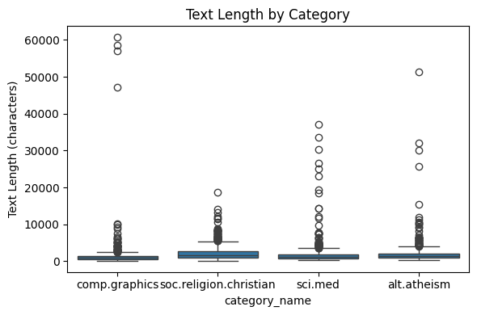
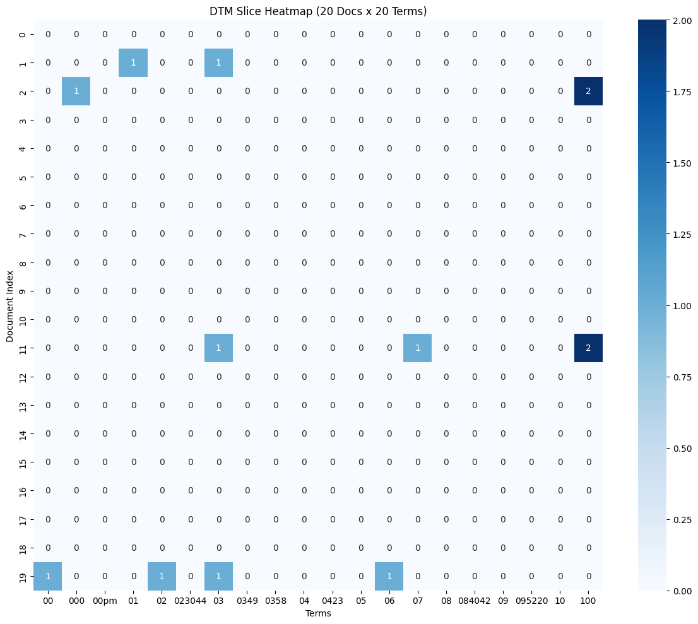
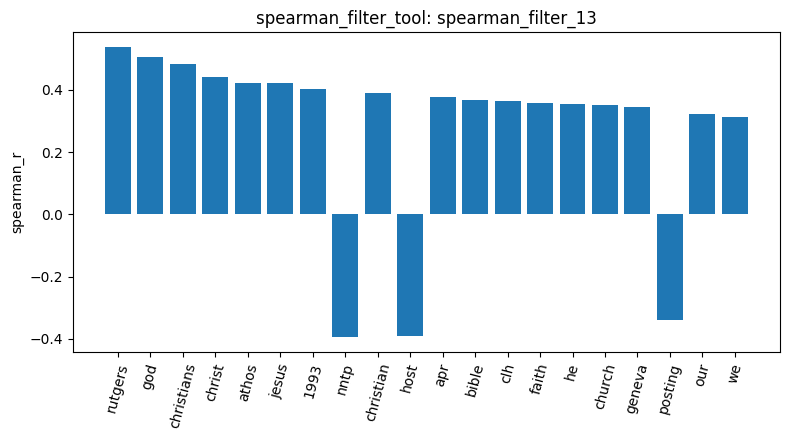
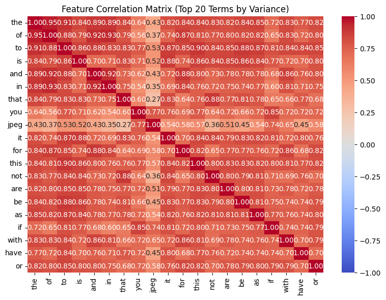
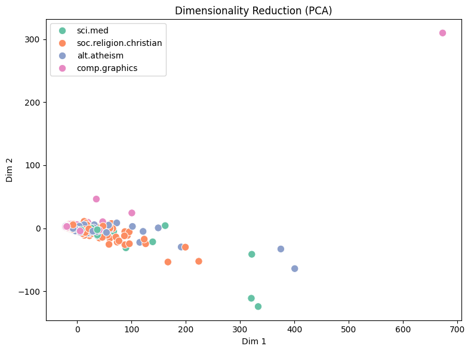
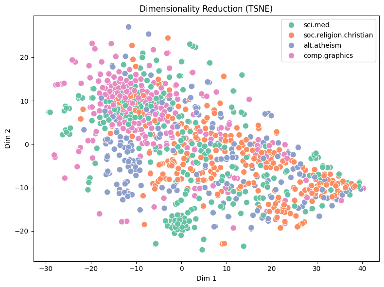
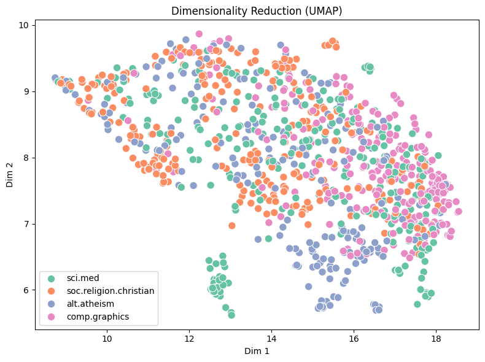

# AgenticPipeline report
## 1. Dataset
The dataset has 2,257 documents in 4 categories (`result_id: load_dataset_1`):

| Category | Documents |
|---|---|
| soc.religion.christian | 599 |
| sci.med | 594 |
| comp.graphics | 584 |
| alt.atheism | 480 |
| **Total** | **2,257** |

Inspecting the first 10 rows (`result_id: inspect_data_2`) shows three columns, `text`, `category` and `category_name`, where each `text` is a raw newsgroup post. There are no missing texts (`result_id: check_missing_3`) and no duplicate documents (`result_id: check_duplicates_4`), so no documents were dropped.

| Row | category_name | category | Subject (from text) |
|---|---|---|---|
| 0 | comp.graphics | 1 | Converting images to HP LaserJet III? |
| 1 | comp.graphics | 1 | help: Splitting a trimming region along a mesh |
| 2 | soc.religion.christian | 3 | Re: harrassed at work, could use some prayers |
| 3 | soc.religion.christian | 3 | catholic church poland |
| 4 | soc.religion.christian | 3 | Re: Elder Brother |
| 5 | soc.religion.christian | 3 | Re: The arrogance of Christians |
| 6 | soc.religion.christian | 3 | Re: anger |
| 7 | sci.med | 2 | Re: Teenage acne |
| 8 | sci.med | 2 | Re: Blindsight |
| 9 | sci.med | 2 | Need advice with doctor-patient relationship problem |

## 2. Document Length

Across all documents (`result_id: describe_data_5`) the median length is 1,235 characters but the mean is 1,992.96 and the maximum is 60,713, so a few very long posts pull the mean far above the median.

The box plot shows long outliers in every category, only soc.religion.christian is more consistent, with the smallest std (2,080.25), whereas comp.graphics varies the most (largest std, 4,684.77).

## 3. Sampling and Document-Term Matrix
I randomly sampled 1,000 of the 2,257 documents as the working set (`result_id: sample_data_6`, random state 42), then built a document-term matrix on them (`result_id: dtm_7`). The matrix keeps the 10,000 most frequent terms (ranked by term frequency across all documents) and has 144,015 non-zero entries out of 10,000,000 (sparsity 98.56%).

Since `build_dtm_tool` keeps stopwords, the 10 most frequent terms (`result_id: term_frequency_8`) are all English stopwords: the (13,284), to (7,787), of (7,742), is (5,664), and (5,565), in (5,110), that (5,015), it (3,751), you (2,814) and for (2,655).
 
A heatmap of the first 20 documents and 20 terms (`result_id: dtm_heatmap_9`) is almost empty. Since the slice is positional and the terms are in alphabetical order, so it only covers rare numeric tokens (`00`, `000`, `00pm`, ...).

## 4. Variance Filtering
I applied `variance_filter_tool` with thresholds of 0.01 and 0.05 ( `variance_filter_11`, `variance_filter_12`). A threshold of 0.01 removes 5,555 of the 10,000 terms (4,445 kept) and 0.05 removes 8,458 (1,542 kept). Since the original document-term matrix is very sparse (98.56%), I chose 0.05, which filters out about 85% of the terms while keeping those that vary enough across the 1,000 documents.

## 5. Correlation Filtering
I ran `spearman_filter_tool` against the category `soc.religion.christian` (`result_id: spearman_filter_13`). I chose Spearman because it captures monotonic relationships and not only linear ones. With a threshold of 0.1 on |r|, 721 of the 10,000 terms were kept and 9,279 removed. I kept 0.1 because it is already a weak correlation, so the large number of removed terms shows that most terms are almost unrelated to this category.

Following bar chart shows the 20 terms with the highest |r| for `soc.religion.christian` (from `result_id: spearman_filter_13`). Most of the positive correlated terms are related to religion words.

## 6. Feature Correlation
I used `feature_correlation_matrix_tool` with `top_k=20` (`result_id: feature_correlation_14`). The tool selects the 20 terms with the highest variance from the full document-term matrix and I found that these 20 terms are almost all stopwords (the, of, to, is, and, in, that, you, ...). Because the global matrix keeps stopwords, these very common terms appear in almost every document, and their counts grow with document length. Since document lengths differ greatly, their counts vary a lot between documents, giving them the highest variance. Also, the following heatmap shows that all pairs of these terms are positively correlated (e.g. the–of: 0.9471, the–to: 0.9097, you–if: 0.8538, jpeg–you: 0.7720).

## 7. Frequent Pattern Mining
I ran `mine_patterns_tool` once for each of the four categories with the same settings: filtering method `term_frequency`, algorithm `maxfpgrowth` and `min_sup=9`. 

Following are the reason for choosing them:
- `term_frequency`: Because the Master notebook selected `minSup=9` specifically for this filter. It keeps terms whose total count lies between the 5th and 95th percentile.
- `maxfpgrowth`: Because it only returns maximal patterns (those not contained in a larger frequent pattern), which gives a more concise result without redundant sub-patterns. 

(Note: Base on `TOOLS_PIPELINE_BREAKDOWN.md`, for each call the tool builds a fresh document-term matrix from that category's documents only, removes English stopwords.)

The Result of 4 categories:

| Category | `result_id` | Surviving terms | Patterns | Highest support |
|---|---|---|---|---|
| soc.religion.christian | `mine_patterns_15` | 4,433 | 341 | 17 (`born`) |
| sci.med | `mine_patterns_16` | 5,023 | 250 | 16 (`greatly`) |
| comp.graphics | `mine_patterns_17` | 3,586 | 95 | 14 (`greatly`, `summary`, `sorry`) |
| alt.atheism | `mine_patterns_18` | 3,550 | 186 | 16 (`exactly`, `inimitable`) |

The top patterns are mostly single, generic words, and they are not clearly specific to their category. Category-specific words such as `god`, which ranked highly in the Spearman result, are absent from the top patterns. This is likely because the `term_frequency` filter drops the most frequent 5% of terms, which probably include the main topical words of each category. In addition, the raw posts contain header and numeric fragments, so tokens like `gmt`, `deleted` and `1993apr5` appear in the alt.atheism patterns. 

As a comparison, I mined `soc.religion.christian` with different filters and `min_sup` values:

| `result_id` | Filter | `min_sup` | Surviving terms | Patterns | Highest support |
|---|---|---|---|---|---|
| `mine_patterns_15` | `term_frequency` | 9 | 4,433 | 341 | 17 |
| `mine_patterns_19` | `tfidf` | 9 | 7,231 | 126,134 | 13 |
| `mine_patterns_20` | `tfidf` | 80 | 7,231 | 28 | 102 |

`tfidf` keeps more terms, and with the low `min_sup` it produces too many patterns. Raising `min_sup` to 80 (the Master value for `tfidf`) makes the result readable, but the patterns are still dominated by email header words (`lines`, `subject`, `organization`, `edu`), with topical words like `jesus` and `god` appearing only alongside them. This suggests the raw headers, not only the parameters, limit how topical the patterns are.

## 8. Dimensionality Reduction
I reduced the document-term matrix to two dimensions with PCA, t-SNE and UMAP (`result_id: reduce_dimensions_21`, `_22`, `_23`), and colored the 1,000 documents by category.

In the PCA plot most documents collapse into one small region, with a few far-away outliers; the first component explains 68.22% of the variance and the second 6.13%. It may because it only captures linear directions of maximum variance.
In the t-SNE and UMAP plots the categories overlap heavily, with only a weak tendency to group. This is likely because the matrix contains raw counts including stopwords, so documents look similar to each other and the counts mainly reflect document length rather than topic. 

## 9. Label Binarization
Converted the four category labels into a one-hot (binary) matrix with `binarize_labels_tool` (`result_id: binarize_labels_24`). The result has shape 1,000 × 4, with one column per class and exactly one 1 per row in the sample shown. 

## 10. Cosine Similarity
I compared document pairs with `cosine_similarity_tool`:

| `result_id` | Document 1 | Document 2 | Cosine similarity |
|---|---|---|---|
| `cosine_similarity_25` | 1 (soc.religion.christian) | 3 (soc.religion.christian) | 0.4049 |
| `cosine_similarity_26` | 1 (soc.religion.christian) | 0 (sci.med) | 0.2548 |

The pair from the same category is more similar than the pair from different categories. However, the different-category pair is still far from 0, which is likely because the document-term matrix contains stopwords and email header words and make these 2 different category document seems slightly similar.
