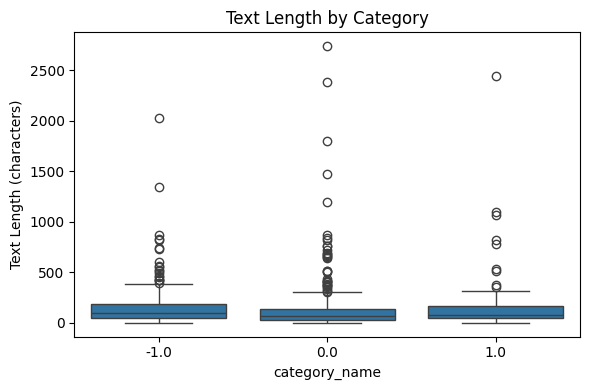
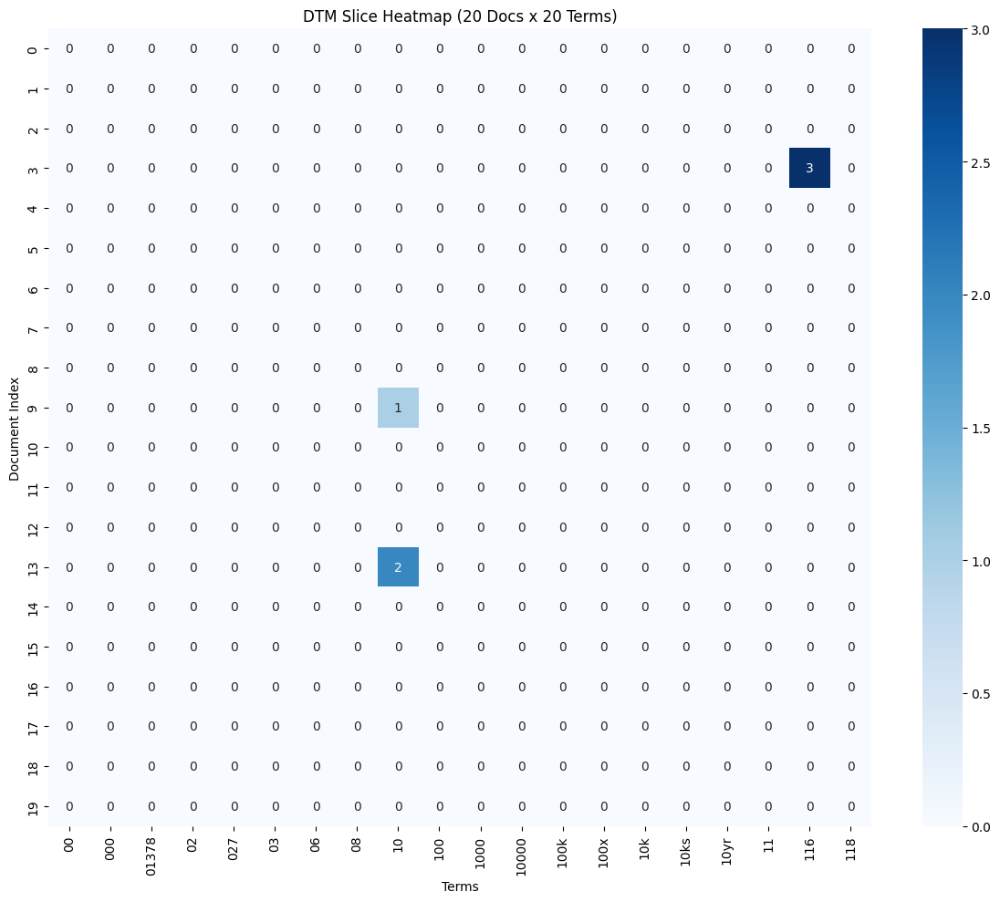
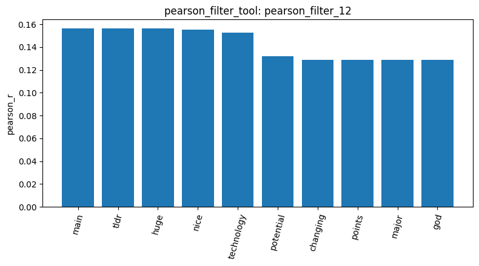
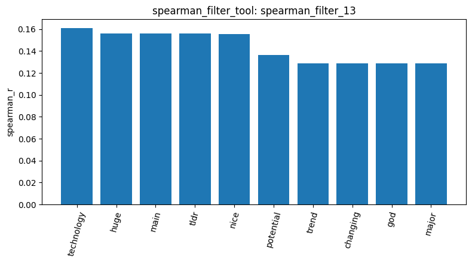
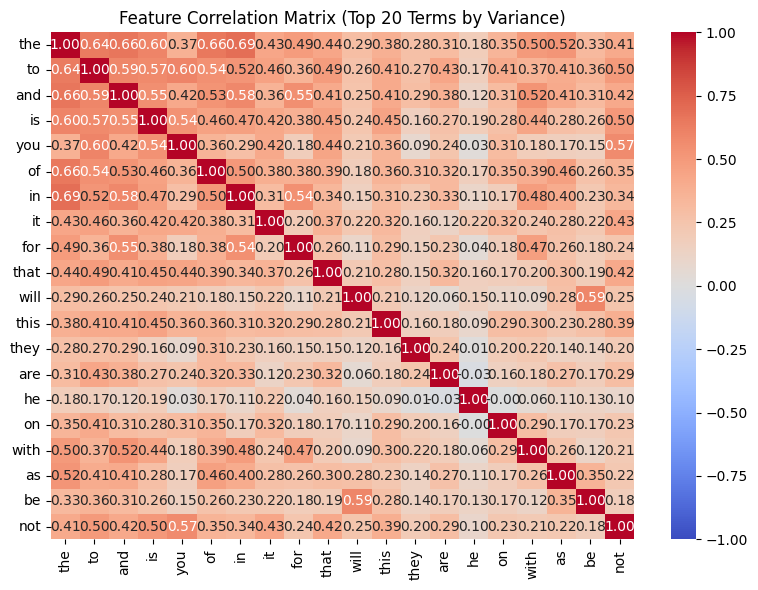
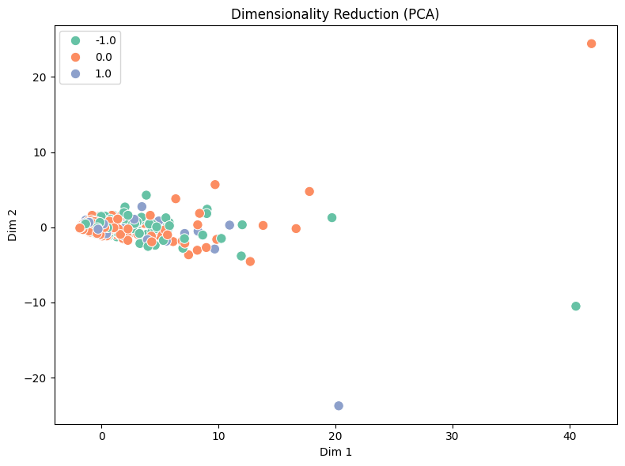
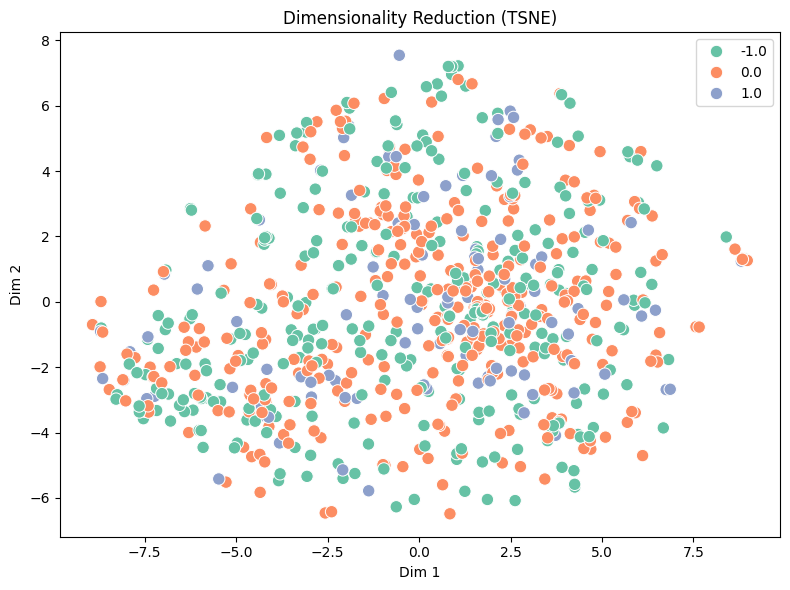
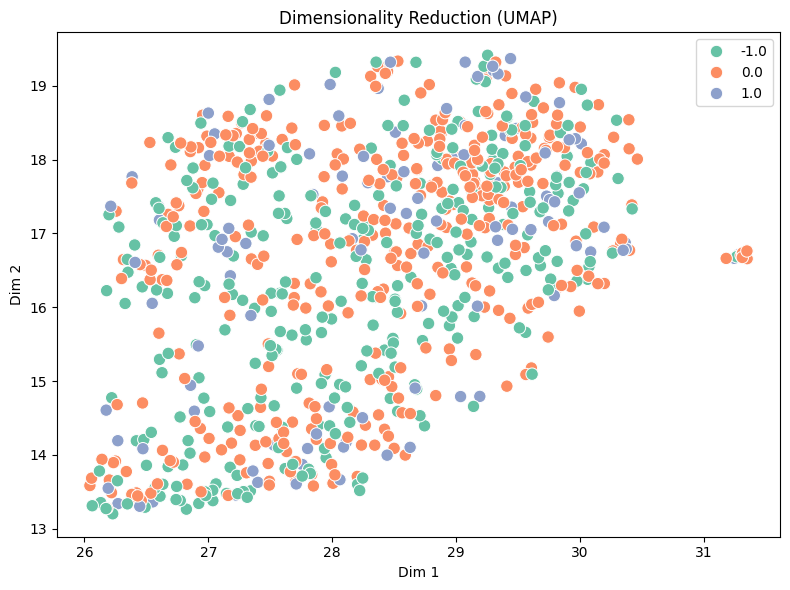

# Homework report 
## 1. Dataset
The dataset has 847 Reddit posts and comments about stocks (`result_id: load_dataset_1`). The first five rows (`result_id: inspect_data_2`) show three columns: `text` (the post or comment), `category_name` (the sentiment label) and `category` (a numeric class id). The documents fall into 3 sentiment classes and no missing texts (`result_id: check_missing_3`): all 847 documents have a text value (0 missing, 0.0%).

| Category (`category_name`) | Sentiment | Documents |
|---|---|---|
| 0.0 | neutral | 423 |
| -1.0 | negative | 315 |
| 1.0 | positive | 109 |
| **Total** | | **847** |

| Row | category_name | category | Text |
|---|---|---|---|
| 0 | -1.0 | 0 | Calls on retards |
| 1 | 0.0 | 1 | Stunt as in like why did they even make a big ... |
| 2 | 0.0 | 1 | Seeing lots of red in the ticker. |
| 3 | 1.0 | 2 | Vision Marine Technologies Inc. is rewriting t... |
| 4 | -1.0 | 0 | He didn’t say thank you. |

Then, `check_duplicates_tool` found 23 duplicate rows (`result_id: check_duplicates_4`, 2.72% of 847), and I removed them with `drop=True` (`result_id: check_duplicates_5`). The tool does not count the first occurrence of a duplicated row as a duplicate, but removes it along with the other copies, so 34 rows were deleted rather than 23.

| | Documents |
|---|---|
| Before removal (`check_duplicates_4`) | 847 |
| Rows removed (all copies of duplicated rows) | 34 |
| After removal (`check_duplicates_5`) | 813 |

## 2. Document Length
After removing the duplicates, 813 documents remain: 315 negative, 391 neutral and 107 positive. Their lengths (`result_id: describe_data_6`) are short and strongly right-skewed: the median is 78 characters, but the mean is 147.19 and the maximum is 2,737, so a few very long posts pull the mean far above the median.

| Category | Documents | Mean | Median | Std | Max |
|---|---|---|---|---|---|
| -1.0 (negative) | 315 | 152.82 | 96.0 | 190.70 | 2,028 |
| 0.0 (neutral) | 391 | 137.87 | 68.0 | 257.42 | 2,737 |
| 1.0 (positive) | 107 | 164.64 | 77.0 | 292.14 | 2,444 |

According to the boxplot and table, the three categories show the same pattern. Every category has a median well below its mean and a few extreme outliers in the box plot. Also, the medians differ somewhat, but the box plot shows the interquartile ranges overlap heavily, so document length alone does not separate the sentiments.

## 3. Sampling and Document-Term Matrix
I did not sample the data because only 813 documents remain after removing the duplicates. Instead, I built the document-term matrix on all of them with the default settings (`result_id: dtm_7`):

| Setting | Value | Effect |
|---|---|---|
| `ngram_range` | [1, 1] | single words only |
| `max_features` | None | no cap on the vocabulary size |
| `min_df` | 1 | no minimum document frequency |
| `max_df` | 1.0 | no maximum document frequency |

And stopwords are not removed. The resulting matrix has 4,313 terms and  sparsity of 99.52%.

Because stopwords are kept, they also dominate the term frequencies (`result_id: term_frequency_8`): the 10 most frequent terms are all English stopwords, namely the (874), to (554), and (471), is (386), it (338), of (299), in (278), that (220), for (209) and this (209). 

Further more, the heatmap (`result_id: dtm_heatmap_9`) shows the same sparsity from another angle. It covers the first 20 documents and the first 20 terms, which are selected by position. Since the vocabulary is sorted alphabetically, these terms are all numeric tokens and only three cells are non-zero. 

## 4. Variance Filtering
I chose 0.01 as threshold because a threshold of 0.05 keeps only 93 of the 4,313 terms (`variance_filter_11`), and the sample of kept terms is dominated by stopwords, which have high variance because they appear often and their counts change with document length. A threshold of 0.01 keeps 490 terms (`variance_filter_10`), which still include stopwords and some rare tokens, but also more content words.

## 5. Correlation Filtering
Pearson (`pearson_filter_12`) and Spearman (`spearman_filter_13`) give very similar results for category "1.0": they keep 41 and 39 terms at |r| ≥ 0.1, the top terms mostly overlap, and the two bar charts look alike. This suggests that, on this data, the monotonic view adds little over the linear one. However, all correlations are weak (the highest is about 0.16), so no term is strongly related to positive sentiment.

## 6. Feature Correlation
The 20 terms with the highest variance (`result_id: feature_correlation_14`) are all stopwords, because stopwords are frequent and are not removed from the matrix. The heatmap shows that their correlations are positive. This is probably because longer posts contain more of every common word, so the counts rise together. Also, some pairs are stronger, such as the–in (0.6922), the–and (0.6591), the–of (0.6552), the–to (0.6380), will–be (0.5906) and you–not (0.5666). A possible reason is grammar, since words like will and be often appear together in English, but this matrix only compares word counts across posts and cannot tell whether the words really occur next to each other. 

## 7. Frequent Pattern Mining
 Since there is no Master result for this dataset to compare, I used `topk` (k = 10) first to see how large the supports are before choosing `min_sup`. I started with `term_frequency` filtering, as in the earlier pipeline run, on the positive category. It kept 226 terms, but all top 10 patterns were single words with support 3 (`result_id: mine_patterns_15`). I think that may because the posts are short and this filter drops the most frequent terms, so I switched only the filter to `tfidf`, which kept 832 terms and gave much higher supports (`mine_patterns_16`):

| Filter (positive, `topk`, k = 10) | Surviving terms | Highest support | 10th support | Result |
|---|---|---|---|---|
| `term_frequency` | 226 | 3 (come) | 3 | `mine_patterns_15` |
| `tfidf` | 832 | 15 (just) | 5 (new) | `mine_patterns_16` |

With supports ranging from 15 down to 5, I then switched to `maxfpgrowth` with `min_sup` = 4, and used the same settings on the other two categories:

| Category | Documents | Surviving terms | Maximal patterns | Highest support | Result |
|---|---|---|---|---|---|
| 1.0 (positive) | 107 | 832 | 32 | just (15) | `mine_patterns_17` |
| 0.0 (neutral) | 391 | 1,991 | 233 | does (12) | `mine_patterns_18` |
| -1.0 (negative) | 315 | 1,589 | 225 | fuck (14) | `mine_patterns_19` |

The positive category yields far fewer patterns and lower supports, which fits its much smaller number of documents, so its patterns are based on little evidence. In all three categories the top 10 patterns shown are single words, (cannot say whether longer patterns exist among the rest) some frequent words appear in more than one category ("doing" in positive and negative, "way" in positive and neutral), but others clearly fit their category, such as "fuck" and "bad" in the negative category and "good" in the positive one.

## 8. Dimensionality Reduction
I reduced the document-term matrix to 2 dimensions with PCA, t-SNE and UMAP (`result_ids: reduce_dimensions_20`, `reduce_dimensions_21`, `reduce_dimensions_22`). In PCA the first two components explain only 31.82% of the variance, and the documents are packed into one dense group with all three sentiment categories overlapping. Since only PCA is packed together, possibly because it is linear and cannot capture non-linear structure, and because stopwords and raw counts dominate the matrix. t-SNE and UMAP, which are non-linear, spread the documents out, but the categories are still mixed together.

I reduced the document-term matrix to 2 dimensions with PCA, t-SNE and UMAP (`result_ids: reduce_dimensions_20`, `reduce_dimensions_21`, `reduce_dimensions_22`)

## 9. Label Binarization
`binarize_labels_tool` (`result_id: binarize_labels_23`) turned the sentiment labels of all 813 documents into a 813 × 3 one-hot matrix, with one column per class. For example (the first 5 rows):

| Row | category_name | -1.0 | 0.0 | 1.0 |
|---|---|---|---|---|
| 0 | -1.0 | 1 | 0 | 0 |
| 1 | 0.0 | 0 | 1 | 0 |
| 2 | 0.0 | 0 | 1 | 0 |
| 3 | 1.0 | 0 | 0 | 1 |
| 4 | -1.0 | 1 | 0 | 0 |

## 10. Cosine Similarity
I computed the cosine similarity of four pairs of documents, three from the same category (negative, "-1.0") and one across categories:

| Documents | Categories | Cosine similarity | Result |
|---|---|---|---|
| 0 and 4 | -1.0 and -1.0 | 0.0 | `cosine_similarity_24` |
| 4 and 6 | -1.0 and -1.0 | 0.0 | `cosine_similarity_26` |
| 17 and 18 | -1.0 and -1.0 | 0.2041 | `cosine_similarity_28` |
| 8 and 17 | 1.0 and -1.0 | 0.1575 | `cosine_similarity_29` |

The first two pairs share no word in the document-term matrix, while documents 17 and 18 share the words "trump" and "and", and documents 8 and 17, from opposite sentiment categories, share "the", "was", and "on". Because the posts are short, two documents can easily have no word in common, which gives a cosine similarity of exactly 0.0, even when they belong to the same category. Documents from different categories can still have a non-zero similarity, because they may share some common words.